# 09 · Verificación de requerimientos

> Cómo cumple Folio cada requerimiento de [`requerimientos.txt`](./requerimientos.txt): **qué pide, cómo se cumple, en qué parte del código está, cómo verlo tú mismo y qué prueba automática lo demuestra.**
> Fecha: 2026-10-20 (fase 4, con backend) · Sitio de demostración: https://franjmd0508.github.io/multiagente-inteligente-ebooks/
> Pruebas: frontend en modo demo [`requisitos.spec.ts`](../frontend/e2e/requisitos.spec.ts) y [`portada-referencias.spec.ts`](../frontend/e2e/portada-referencias.spec.ts) (**20 de 20 superadas**); backend [`pytest`](../backend/tests) (**122 de 122**); punta a punta con el backend real [`backend.spec.ts`](../frontend/e2e/backend.spec.ts) (**1 de 1**). Detalle del backend en [11-backend](./11-backend.md) §7.

## Resumen

| Estado | Significado | Requerimientos |
|---|---|---|
| ✅ **Cumple** | Funciona en el sistema (en el modo demo y con el backend) y lo comprueba una prueba automática. | RF-01, RF-02, RF-03, RF-04, RF-05, RF-06, RNF-04, RA-01, RA-03, RÉR-02, RD-04, RD-09 |
| 🟡 **Implementado; falta medirlo con el modelo real** | El backend ya tiene los mecanismos (prompts con reglas explícitas, capítulo ancla, guía de estilo, tiempo límite, verificación) y las pruebas pasan con el proveedor demo, pero la calidad del texto se tiene que medir con capítulos escritos por Gemini. | RNF-01, RNF-02, RNF-03, RA-02, RÉR-01, RÉR-03 |

> **Por qué sigue habiendo 🟡:** estos requisitos tratan de *cómo escribe la IA* (tono, tiempos, coherencia, claridad, originalidad, sesgos). El backend los atiende con los prompts y controles de [11-backend](./11-backend.md) §3-4, pero en la máquina donde se verificó no había clave de Gemini: las pruebas usan el proveedor **demo**, que devuelve textos de plantilla con la misma forma. Con la clave puesta en `backend/.env`, hay que repetir la medición de tono, legibilidad (INFLESZ), tiempo por capítulo y sesgos sobre un libro real.

**Guía de estudio en PDF:** [`guia/Folio-guia-de-requerimientos.pdf`](guia/Folio-guia-de-requerimientos.pdf) explica lo mismo ficha por ficha: qué decir en voz alta, **dónde verlo paso a paso con capturas señaladas**, preguntas probables y un guion de demostración de 5 minutos. Se regenera con `npm run guia:capturas` y `npm run guia:pdf`.

**Cómo usar el sitio para verificar:** entra con **“Continuar con Google”** (acceso simulado). Si quieres ir rápido, activa **Ajustes → Demostración → Velocidad: Rápida**. La biblioteca de ejemplo trae libros en distintas etapas.

**Con los agentes reales:** en Windows, `.\iniciar-folio.ps1` desde la raíz del repositorio arranca el backend y el frontend conectados (ver [`backend/README.md`](../backend/README.md)). Crea una cuenta y escribe tu idea.

**Cómo repetir las pruebas:**

```bash
cd frontend
npm run test:e2e          # 20 pruebas en modo demo, ~2,5 minutos; capturas en e2e/evidencias/
npm run test:e2e:backend  # punta a punta con el backend real (proveedor demo, datos temporales)
cd ../backend && .venv/Scripts/python -m pytest   # 122 pruebas del backend, ~45 s
E2E_BASE_URL=https://franjmd0508.github.io/multiagente-inteligente-ebooks npm run test:e2e   # contra el sitio publicado
```

---

## Requerimientos funcionales

### RF-01 · Selección de nicho y temática cotidiana — ✅ Cumple

**Qué pide:** elegir o parametrizar nichos de crecimiento personal basados en situaciones reales, **descartando la ficción**.

**Cómo lo cumple**
- El inicio ofrece nichos de situaciones reales como chips (Finanzas para universitarios, Gestión del tiempo, Resolver conflictos, Primer empleo, Hábitos y rutinas). También admite una idea libre, y el sistema detecta a qué nicho pertenece.
- Si la idea es de ficción (novela, cuento, dragones, poema…), **no se crea el ebook**. Aparece “Folio crea guías prácticas sobre situaciones reales” con tres alternativas de no ficción.

**Dónde está**
- Catálogo de nichos: `frontend/src/lib/niches.ts:16` (`NICHES`) y detección `:115` (`detectNiche`)
- Guardarraíl de ficción: `frontend/src/lib/guardrails.ts:23` (`isFiction`)
- Bloqueo al enviar: `frontend/src/app/(app)/page.tsx:55` (`api.checkTopic`); con backend, además, `backend/app/graph/guardrail.py:121` (patrones + clasificación del LLM)

**Cómo verlo**
1. En el inicio, toca un chip: la caja se llena con una idea editable.
2. Escribe “Escribe una novela de dragones” y envía: aparece el mensaje con alternativas y no se crea nada.

**Prueba:** `RF-01` comprueba que hay 5 o más nichos, que un chip rellena la idea y que la ficción no crea ningún ebook.

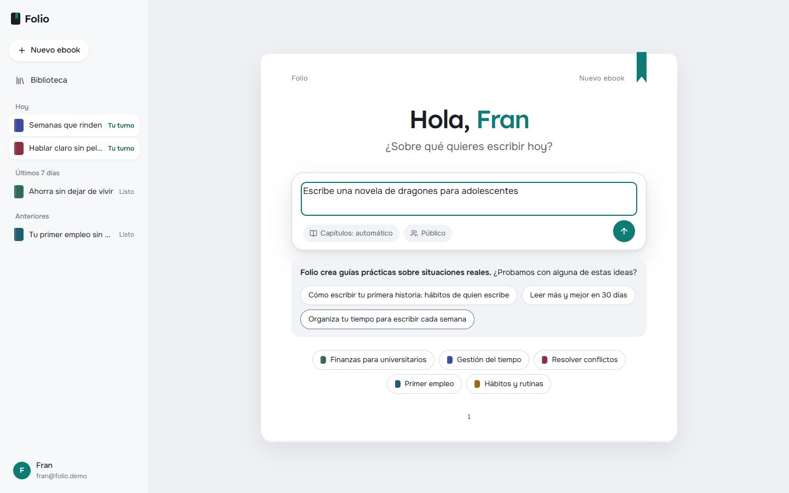

---

### RF-02 · Temario de 5 a 7 capítulos — ✅ Cumple

**Qué pide:** el Agente Investigador propone un temario con un **límite estricto** de 5 a 7 capítulos.

**Cómo lo cumple**
- Al crear el ebook solo se puede elegir 5, 6, 7 o automático (6).
- En el índice, con 5 capítulos los botones de **quitar se desactivan**; con 7, el botón de agregar dice “7 capítulos · máximo alcanzado” y queda desactivado. Un mensaje explica el límite.
- La capa de datos vuelve a validar el rango aunque se intente saltar la interfaz.

**Dónde está**
- Límites: `frontend/src/lib/types.ts:146` (`MIN_CHAPTERS` / `MAX_CHAPTERS`)
- Validación: `frontend/src/lib/api/index.ts:75` (`addOutlineItem`) y `:96` (`removeOutlineItem`)
- Interfaz: `frontend/src/components/workspace/stages/OutlineReview.tsx:186`
- Número de capítulos generados: `frontend/src/lib/api/mock/content.ts:308`

**Cómo verlo**
1. En el inicio, toca la píldora “Capítulos: automático”, elige **5** y crea el ebook.
2. En el índice, los íconos de papelera aparecen desactivados.
3. Toca “Agregar capítulo” dos veces: llegas a 7 y el botón se desactiva.

**Prueba:** `RF-02` comprueba 5 capítulos con quitar desactivado, 7 con agregar desactivado y 6 en automático.

| Mínimo (5) | Máximo (7) |
|---|---|
| 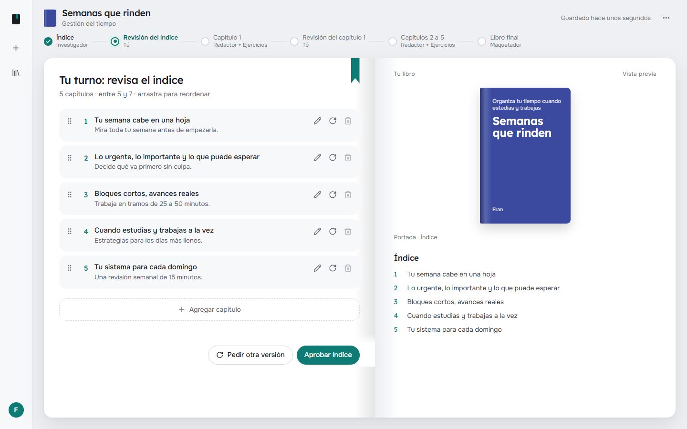 | 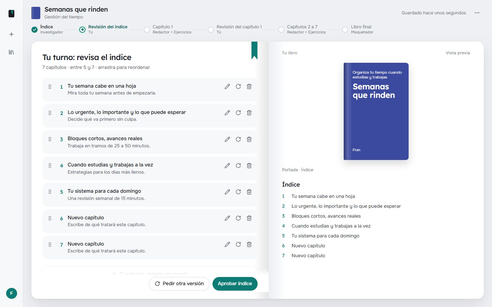 |

---

### RF-03 · Estructura estandarizada del capítulo — ✅ Cumple

**Qué pide:** cada capítulo incluye **Introducción, Desarrollo, Ejemplos cotidianos, Conclusión y Ejercicio práctico**.

**Cómo lo cumple**
- El generador produce siempre las cuatro secciones y el Agente de Ejercicios añade la quinta.
- La hoja del capítulo las muestra en ese orden. En la revisión del capítulo 1 se ven marcadas como “Estructura”.
- En el editor, los **nombres de sección son fijos** (con candado): se puede cambiar el contenido, pero no borrar una sección.

**Dónde está**
- Orden de secciones: `frontend/src/lib/types.ts:25` (`SECTION_ORDER`)
- Generación: `frontend/src/lib/api/mock/content.ts:362` (`generateChapter`)
- Hoja del capítulo: `frontend/src/components/book/ChapterPage.tsx:40`; chips de estructura: `:84`
- Editor con secciones fijas: `frontend/src/components/workspace/stages/TextEditor.tsx:200`

**Cómo verlo:** abre “Hablar claro sin pelear” (en tu turno, capítulo 1). En “Tu libro” verás las cinco secciones y a la izquierda la lista “Estructura”.

**Prueba:** `RF-03` comprueba que los encabezados de sección son exactamente esos cinco y en ese orden.

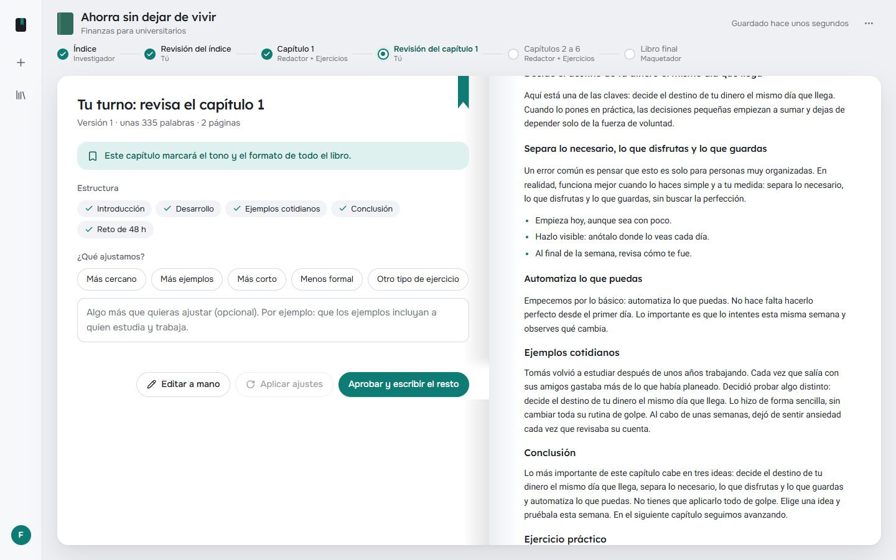

---

### RF-04 · Ejercicios prácticos rápidos — ✅ Cumple

**Qué pide:** **solo** checklists de autoevaluación o retos de 24 a 48 horas.

**Cómo lo cumple**
- El tipo de ejercicio solo admite dos formas: `checklist` o `reto` con duración `24h` o `48h`. No existe otra opción en el modelo de datos.
- Por defecto alternan (retos en capítulos impares, checklists en pares). Se puede fijar la preferencia en Ajustes o cambiarla con “Otro tipo de ejercicio”.

**Dónde está**
- Tipo de dato cerrado: `frontend/src/lib/types.ts:36` (`Exercise`)
- Generación: `frontend/src/lib/api/mock/content.ts:446` (`generateExercise`)
- Presentación: `frontend/src/components/book/ChapterPage.tsx:7` (`ExerciseBox`)

**Cómo verlo:** abre un libro listo y desplázate al final de cualquier capítulo, a la sección “Ejercicio práctico”.

**Prueba:** `RF-04` revisa los 6 capítulos. Resultado: reto de 48 h, checklist, reto de 24 h, checklist, reto de 48 h, checklist.

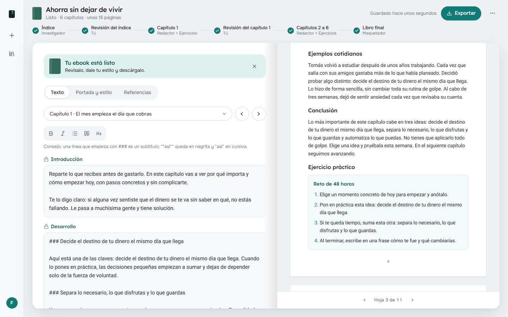

---

### RF-05 · Puntos de validación humana (HITL) — ✅ Cumple

**Qué pide:** el sistema **se detiene** tras proponer el índice y tras escribir el capítulo 1, y espera la aprobación.

**Cómo lo cumple**
- El pipeline termina en el estado `indice_pendiente` y **no sigue** hasta que tocas “Aprobar índice”. Lo mismo con `cap1_pendiente` y “Aprobar y escribir el resto”.
- La pausa se ve con claridad: cae la cinta, la fase se llama “Revisión del índice · Tú” y el libro aparece como “Tu turno” en la biblioteca.
- **La pausa sobrevive a cerrar el navegador:** al volver, el libro sigue en el mismo punto.

**Dónde está**
- Pausas: `frontend/src/lib/api/mock/simulator.ts:125` (índice) y `:200` (capítulo 1); con backend, `interrupt()` en `backend/app/graph/nodes.py` (`punto_control_indice` y `punto_control_cap1`)
- Solo continúa al aprobar: `simulator.ts:259` (`approveOutline`) y `:304` (`approveChapterOne`)
- Reanudación tras recargar: `simulator.ts:335` (`resume`); con backend, checkpoints en SQLite y `backend/app/graph/runner.py`
- Fases con “Tú”: `frontend/src/lib/phases.ts:33`

**Cómo verlo**
1. Crea un ebook y espera a “Tu turno: revisa el índice”. Espera todo lo que quieras: no avanza.
2. Cierra el navegador y vuelve a abrirlo: sigue esperando.
3. Aprueba y verás la segunda pausa en el capítulo 1.

**Prueba:** `RF-05` (dos pruebas) comprueba que, tras esperar, no se escribió ningún capítulo, que la pausa sigue después de recargar y que los capítulos 2 a N esperan la segunda aprobación.

| Pausa 1: índice | Pausa 2: capítulo 1 |
|---|---|
| 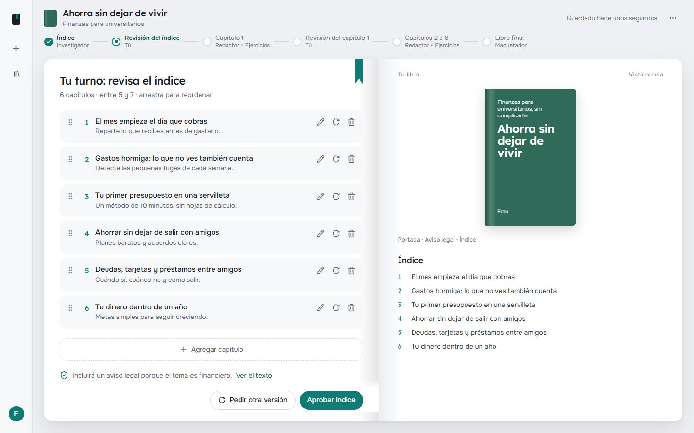 |  |

---

### RF-06 · Exportación a .md y PDF — ✅ Cumple

**Qué pide:** entregar Markdown con sintaxis limpia (encabezados, listas, citas) y compilar a PDF estructurado.

**Cómo lo cumple**
- **Markdown:** se descarga con portada, aviso legal (como cita `>`), índice numerado, capítulos con encabezados, listas y checklists `- [ ]`. Hay un ejemplo real en [`verificacion/ebook-ejemplo.md`](verificacion/ebook-ejemplo.md) (modo demo) y otro generado por el backend en [`verificacion/ebook-ejemplo-servidor.md`](verificacion/ebook-ejemplo-servidor.md), con referencias en APA 7 y contraportada.
- **PDF:** se abre una vista de impresión con el tamaño de página elegido (`@page`) y se guarda como PDF desde el navegador. Sale etiquetado y con marcadores. Ejemplo: [`verificacion/ebook-ejemplo.pdf`](verificacion/ebook-ejemplo.pdf). **Con backend**, el Agente Maquetador genera el PDF en el servidor (Chromium headless, etiquetado, con marcadores, fuentes incrustadas y metadatos de IA): [`verificacion/ebook-ejemplo-servidor.pdf`](verificacion/ebook-ejemplo-servidor.pdf), con portada Editorial e imagen, 7 lecturas verificadas en Crossref y Open Library, y contraportada.
- *Nota:* en la fase 4, el PDF lo generará el Agente Maquetador en el servidor.

**Dónde está**
- Ensamblado del Markdown: `frontend/src/lib/markdown.ts:17` (`buildMarkdown`); con backend, `backend/app/export/markdown.py`
- Diálogo de exportación: `frontend/src/components/workspace/ExportDialog.tsx:26`
- Vista de impresión: `frontend/src/app/imprimir/page.tsx:69` (modo demo); con backend, PDF etiquetado en `backend/app/export/pdf.py`

**Cómo verlo:** abre “Ahorra sin dejar de vivir” (listo) y toca **Exportar**. Elige **Markdown → Descargar**, o **PDF → Descargar**; en ese caso usa “Imprimir → Guardar como PDF” del navegador.

**Prueba:** `RF-06` descarga el Markdown (con encabezados, listas y citas) y genera el PDF desde la vista de impresión.

| Diálogo | Vista de impresión |
|---|---|
| 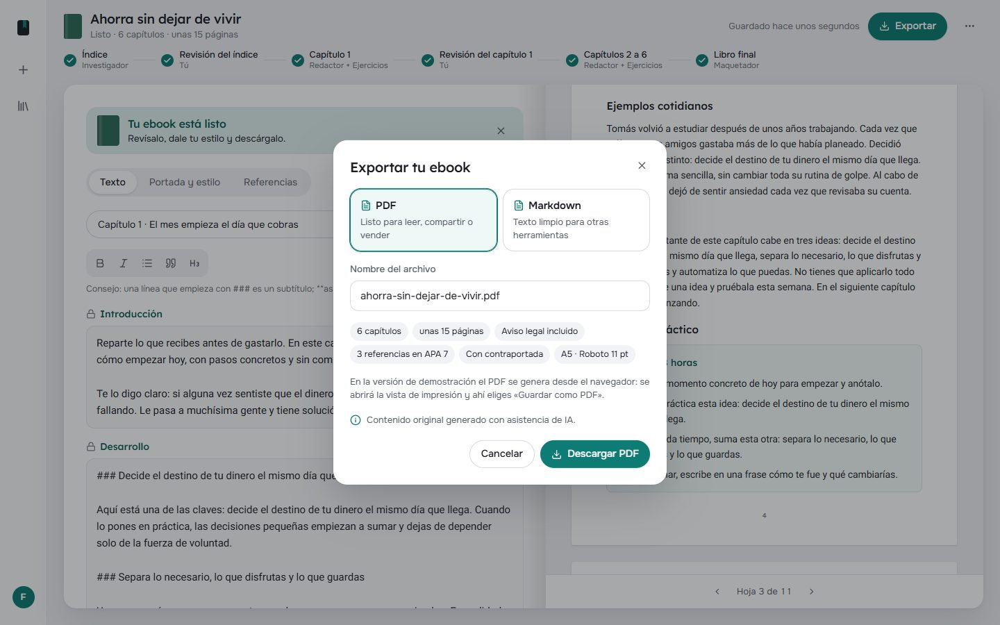 | 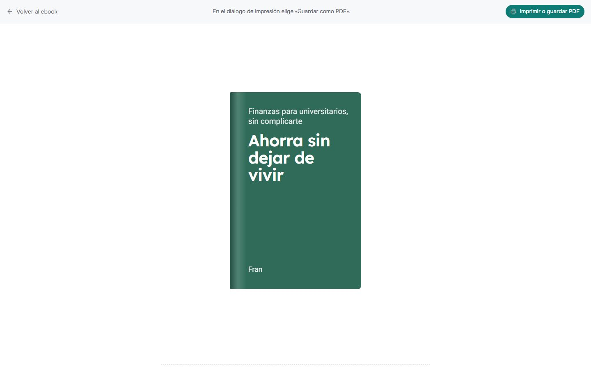 |

---

## Requerimientos no funcionales

### RNF-01 · Tono y estilo de redacción — 🟡 Implementado; falta medirlo con el modelo real

**Qué pide:** tono conversacional, empático y directo, con profundidad intermedia (configuración de temperatura del modelo).

**Cómo lo cumple hoy**
- El contenido simulado está escrito de tú a tú (“vas a ver”, “elige una idea”).
- En la revisión del capítulo 1 hay ajustes de tono de un toque: Más cercano, Más ejemplos, Más corto, Menos formal y Otro tipo de ejercicio. Cada ajuste genera una versión nueva.

**Con backend:** el prompt del Redactor fija el tono (tuteo, conversacional, empático y directo, profundidad intermedia), prohíbe las muletillas de IA y usa temperatura 0,8 (`backend/app/prompts/redactor/capitulo.md:3` y `:9`). Los ajustes del capítulo 1 (chips y campo libre) llegan al Redactor, que reescribe el capítulo y crea una versión nueva. La prueba `test_prompts_tienen_reglas_explicitas` comprueba que las reglas siguen en los prompts.

**Falta:** evaluar el tono con capítulos escritos por Gemini (rúbrica de docs/02 §2).

**Dónde está:** chips `frontend/src/lib/types.ts:226`; efecto en el texto `frontend/src/lib/api/mock/content.ts:378`; nueva versión `frontend/src/lib/api/mock/simulator.ts:319`

**Cómo verlo:** en “Hablar claro sin pelear”, toca **Más cercano → Aplicar ajustes**. Aparece la versión 2 y el texto empieza con “Te lo digo claro”.

**Prueba:** `RNF-01` comprueba el tuteo, los cinco chips y que la versión 2 aplica el ajuste.

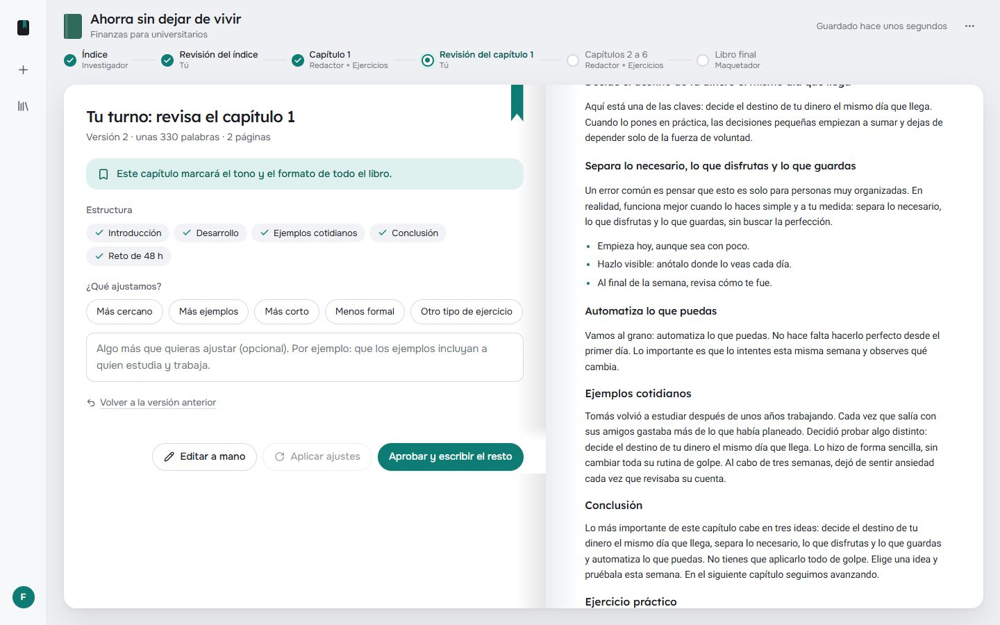

---

### RNF-02 · Menos de 60 segundos por capítulo — 🟡 Implementado; falta medirlo con el modelo real

**Qué pide:** que cada capítulo tarde menos de 60 segundos, para mantener un flujo fluido.

**Cómo lo cumple hoy**
- El texto aparece **en vivo** (streaming) con un cursor, además de avance por secciones, tiempo estimado y la posibilidad de leer los capítulos terminados mientras se escriben los demás.
- Con la velocidad normal de la simulación, **el capítulo 1 tardó 7,2 segundos**.

**Con backend:** streaming por SSE desde el primer trozo de texto; tiempo límite de **60 s por intento** (`backend/app/config.py:53`, aplicado en `backend/app/graph/nodes.py:441`), un reintento automático y luego un error reintentable que no pierde lo ya escrito. Lo prueba `test_reintento_automatico_por_tiempo_limite`. Con el proveedor demo, un libro de 6 capítulos se completa en unos 25 s.

**Falta:** medir el tiempo real con Gemini (docs/02 §2: percentil 95 menor de 60 s).

**Dónde está:** streaming `frontend/src/lib/api/mock/simulator.ts:165`; tiempo estimado `frontend/src/components/workspace/stages/Writing.tsx:30`; lectura en vivo `frontend/src/components/workspace/previews/ChapterScroller.tsx:8`

**Cómo verlo:** aprueba un índice con la velocidad **Normal** y mira “Tu libro” mientras se escribe.

**Prueba:** `RNF-02` comprueba que el texto crece mientras se escribe y que el capítulo termina en menos de 60 s (resultado: 7,2 s).

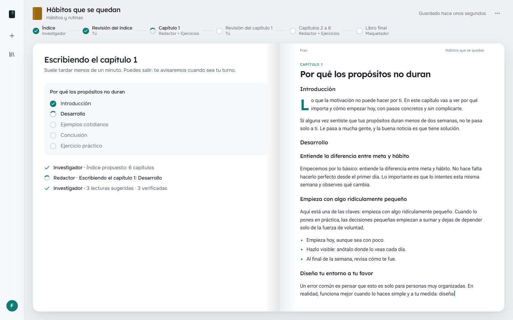

---

### RNF-03 · Consistencia y cohesión textual — 🟡 Implementado; falta medirlo con el modelo real

**Qué pide:** coherencia de términos y estilo en todos los capítulos, sin repeticiones ni contradicciones.

**Cómo lo cumple hoy**
- El capítulo 1 aprobado es el **ancla de tono**, y la interfaz lo dice en dos momentos: en la pausa (“Este capítulo marcará el tono y el formato de todo el libro”) y durante la redacción (“Cada capítulo sigue el tono y el formato del capítulo 1 que aprobaste”).
- Los capítulos se escriben **uno detrás de otro**, nunca en paralelo, para que cada uno conozca los anteriores.

**Con backend:** al aprobar el capítulo 1, el nodo `guia_estilo` extrae la guía de estilo (`backend/app/graph/nodes.py:562`). Cada capítulo recibe el índice, el *brief*, la guía, **el capítulo 1 completo como referencia** y el resumen y la conclusión de los anteriores (`backend/app/agents/redactor.py:188`), con la instrucción de no repetir ni contradecir (`capitulo.md:43`). Los capítulos 2 a N se escriben en orden, uno por paso del grafo.

**Falta:** revisar la coherencia de un libro completo escrito por Gemini.

**Dónde está:** escritura secuencial `frontend/src/lib/api/mock/simulator.ts:204` (`writeRest`); mensajes `ChapterOneReview.tsx:101` y `Writing.tsx:127`

**Prueba:** `RNF-03` muestrea el estado durante la redacción y comprueba que **nunca** hay dos capítulos escribiéndose a la vez.

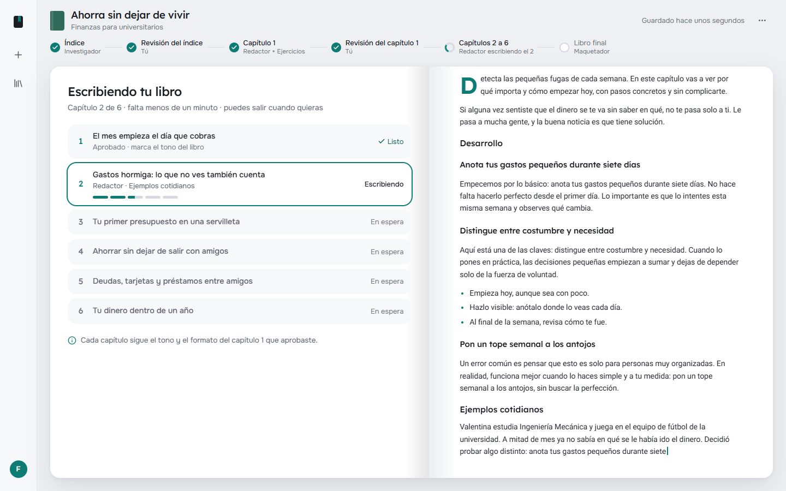

---

### RNF-04 · Arquitectura modular de cuatro agentes — ✅ Cumple

**Qué pide:** un backend modular con Agente Investigador, Redactor, de Ejercicios y Maquetador/Exportador, con prompts intercambiables.

**Cómo lo cumple**
- **Un módulo por agente:** `backend/app/agents/investigador.py`, `redactor.py`, `ejercicios.py` y `maquetador.py`, orquestados por un grafo de LangGraph (`backend/app/graph/builder.py`).
- **Prompts en archivos independientes**, uno por tarea: `backend/app/prompts/<agente>/<tarea>.md`, con la temperatura y el máximo de tokens en su encabezado. Se recargan al editarlos, sin reiniciar el servidor.
- **Proveedor de IA intercambiable** (Gemini, Claude, OpenAI o demo) detrás de `backend/app/llm/`: cambiar de modelo no toca a los agentes.
- La interfaz muestra a los cuatro agentes en las fases y en la bitácora, también con el backend (los textos de la bitácora son los mismos).

**Dónde está:** grafo `backend/app/graph/builder.py:31`; agentes `backend/app/agents/`; prompts `backend/app/prompts/`; capa LLM `backend/app/llm/base.py`; en el modo demo, Investigador `frontend/src/lib/api/mock/simulator.ts:96`, Redactor `:137`, Ejercicios `frontend/src/lib/api/mock/content.ts:446` y Maquetador `simulator.ts:237`; la fachada que elige el modo, `frontend/src/lib/api/index.ts:12`.

**Pruebas:** `RNF-04` (frontend) comprueba que las fases muestran Investigador, Redactor + Ejercicios y Maquetador, y que en la bitácora participan exactamente los cuatro. En el backend, `test_flujo_completo` recorre el grafo completo, `test_prompts_tienen_reglas_explicitas` y `test_formato_de_prompt` validan los archivos de prompts, y `test_llm.py` y `test_llm_sdks.py` prueban cada proveedor.

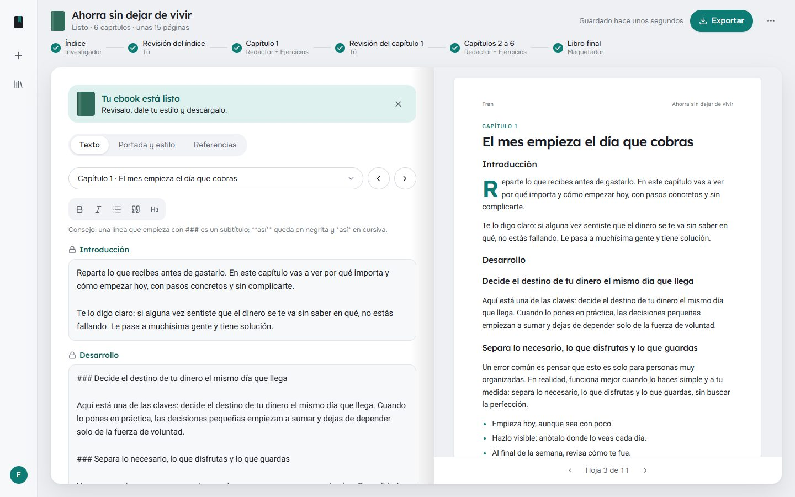

---

## Requerimientos de accesibilidad

### RA-01 · Jerarquía H1/H2/H3 en Markdown y PDF — ✅ Cumple

**Qué pide:** jerarquía clara de encabezados para lectores de pantalla.

**Cómo lo cumple**
- **Markdown:** `#` para el título y cada capítulo, `##` para las secciones y `###` para los subtemas, sin saltar niveles.
- **PDF:** etiquetado (`StructTreeRoot`), con marcadores, idioma `es` y **exactamente H1, H2 y H3**.
- **Editor:** si alguien escribe un `#` o `##` a mano, se convierte en subtítulo `###` para no romper la estructura.

**Dónde está:** capítulos en el Markdown `frontend/src/lib/markdown.ts:32`; conversión en el editor `frontend/src/components/workspace/stages/TextEditor.tsx:13`; portadilla y niveles del PDF `frontend/src/app/imprimir/page.tsx:91`; niveles en la vista previa `frontend/src/components/book/ChapterPage.tsx:63`

**Cómo verlo:** descarga el Markdown y revisa los `#`, o abre el PDF con un lector de pantalla (NVDA, VoiceOver o TalkBack) y navega por encabezados.

**Prueba:** `RA-01` recorre todos los encabezados del Markdown (sin saltos, máximo nivel 3, un H1 por capítulo), lee las etiquetas del PDF (H1, H2, H3) y comprueba que un `#` escrito a mano queda como `###`.

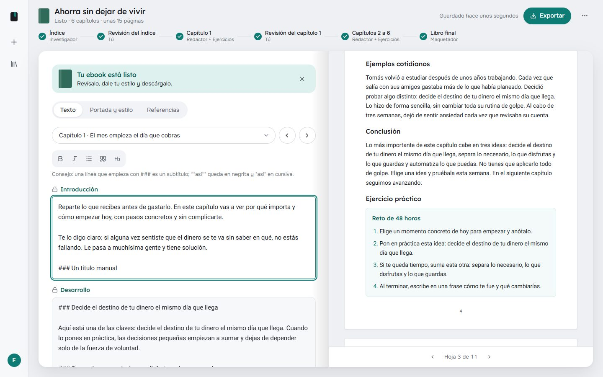

---

### RA-02 · Lenguaje claro y comprensible — 🟡 Implementado; falta medirlo con el modelo real

**Qué pide:** sintaxis directa y explicaciones simples, legibles para público joven o sin formación técnica.

**Cómo lo cumple hoy:** el libro de prueba obtiene **INFLESZ 78,8, “bastante fácil”**, con 9,1 palabras por frase y 1,9 sílabas por palabra (2.305 palabras analizadas). La escala INFLESZ considera 55-65 “normal” y 65-80 “bastante fácil”.

**Con backend:** el prompt del Redactor pide frases de menos de 25 palabras, una idea por párrafo, vocabulario cotidiano y explicar en la misma frase cualquier término técnico (`backend/app/prompts/redactor/capitulo.md:9`).

**Falta:** medir el mismo índice INFLESZ sobre un libro escrito por Gemini.

**Dónde está:** cálculo del índice `frontend/e2e/legibilidad.ts:29`; resultado en [`verificacion/RA-02-legibilidad.json`](verificacion/RA-02-legibilidad.json)

**Prueba:** `RA-02` calcula el índice sobre el libro exportado y exige 55 o más.

---

### RA-03 · Contraste y tipografía limpia en el PDF — ✅ Cumple

**Qué pide:** fondo blanco, texto negro o gris oscuro, Arial, Helvetica o Roboto, y **11 pt como mínimo**.

**Cómo lo cumple**
- “Portada y estilo” **solo ofrece** Roboto, Arial y Helvetica, y tamaños de 11, 12 y 13 pt. No hay forma de elegir menos de 11.
- La hoja del libro es **siempre blanca**, también con el tema oscuro.
- Si eliges un color de portada con poco contraste, avisa y ofrece “Usar el tono accesible”, que garantiza al menos 4,5:1.
- Medido en el PDF: cuerpo a **14,67 px (= 11 pt)** en Roboto, texto `rgb(27,29,35)` sobre `rgb(255,255,255)`, con un **contraste de 16,9:1**.

**Dónde está:** opciones `frontend/src/lib/design.ts:69-70`; tono accesible `design.ts:118`; validación en vivo `frontend/src/components/workspace/stages/DesignPanel.tsx:95`; con backend, la API rechaza una tela sin contraste (`backend/app/design.py`); hoja siempre blanca `frontend/src/app/globals.css:174`

**Cómo verlo:** en un libro listo, abre **Portada y estilo → Color de tela → color personalizado** y elige un amarillo claro. Verás el aviso y el botón para corregirlo.

**Prueba:** `RA-03` comprueba las opciones permitidas, el aviso y la corrección del contraste, y mide tamaño, fuente, fondo y contraste reales en la vista de impresión.

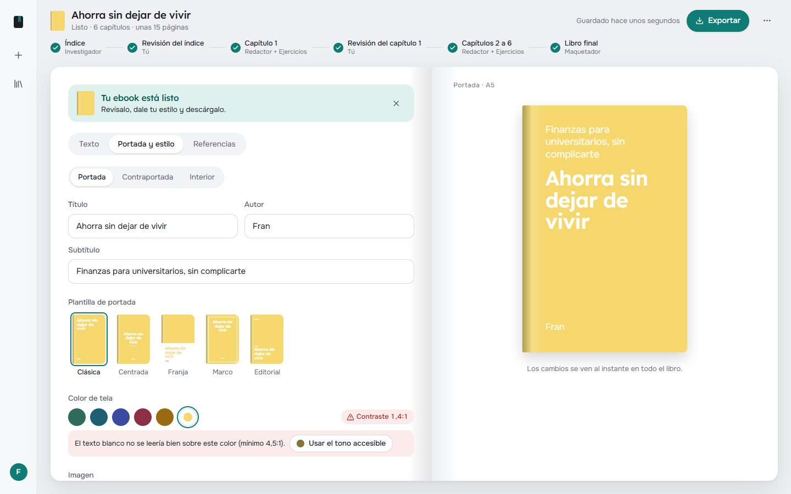

---

## Requerimientos éticos y de responsabilidad

### RÉR-01 · Originalidad y prevención de plagio — 🟡 Implementado; falta medirlo con el modelo real

**Qué pide:** generar contenido original, sin copiar fuentes protegidas.

**Cómo lo cumple hoy**
- Todo el contenido sale de plantillas propias del proyecto; no se copia texto de ninguna fuente externa.
- **Transparencia:** el diálogo de exportación, el Markdown y el PDF indican “Contenido original generado con asistencia de IA”.

**Con backend**
- El Redactor tiene instrucciones explícitas: contenido original con sus palabras, sin copiar ni parafrasear de cerca, sin inventar estudios, cifras ni citas y **sin atribuir frases a personas reales** (`backend/app/prompts/redactor/capitulo.md:39`).
- Si Gemini corta una respuesta por **`RECITATION`** (parecido con un texto existente), se pide otra versión (`backend/app/llm/gemini.py:108`).
- **Fuentes transparentes (RD-09):** las lecturas que sugiere el Investigador se verifican en Crossref y Open Library, y las que no existen se marcan antes de exportar.
- Marca de IA legible por máquina en el `.md` y en los metadatos del PDF (D-39).

**Falta:** una verificación de similitud antes de exportar (opcional en docs/02 §4) y revisar por muestreo un libro escrito por Gemini.

**Dónde está:** `frontend/src/components/workspace/ExportDialog.tsx:146` y `frontend/src/lib/markdown.ts:54`

**Prueba:** `RÉR-01` comprueba la nota en el diálogo y al final del Markdown.

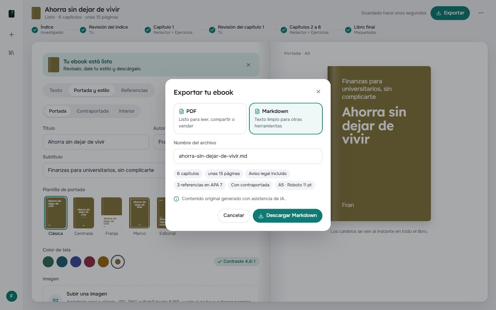

---

### RÉR-02 · Aviso legal en temas sensibles — ✅ Cumple

**Qué pide:** todo ebook de finanzas, emociones o autoayuda incluye **automáticamente** un aviso legal visible.

**Cómo lo cumple**
- Cada tema se clasifica (financiero, salud emocional, salud física, autoayuda) y recibe su texto de aviso.
- Se anuncia **desde el índice** (“Incluirá un aviso legal porque el tema es financiero”, con “Ver el texto”).
- En el libro va **después de la portada y antes del índice**. En el editor aparece bloqueado (“no se puede quitar”) y no hay forma de borrarlo.

**Dónde está:** textos `frontend/src/lib/guardrails.ts:34`; clasificación `frontend/src/lib/niches.ts:22`; aviso en el índice `OutlineReview.tsx:287`; bloque bloqueado `TextEditor.tsx:151`; posición en el libro `frontend/src/lib/markdown.ts:24`

**Cómo verlo**
1. “Ahorra sin dejar de vivir” → Texto → en el selector elige **Aviso legal**: está bloqueado.
2. Crea un ebook sobre “ansiedad antes de un examen”: el aviso es de salud emocional.
3. Crea uno de “Gestión del tiempo”: no lleva aviso.

**Prueba:** `RÉR-02` (dos pruebas) comprueba el aviso en el índice, su posición en el Markdown, el bloqueo en el editor, el caso emocional y la ausencia de aviso en un tema no sensible.

> **Decisión a confirmar:** hoy, Gestión del tiempo, Organización del estudio y Primer empleo **no** llevan aviso, por tratarse de habilidades prácticas. Si prefieres que *todo* ebook de crecimiento personal lo lleve, es un cambio de una línea en `niches.ts`.

| Índice | Editor | Tema emocional |
|---|---|---|
| 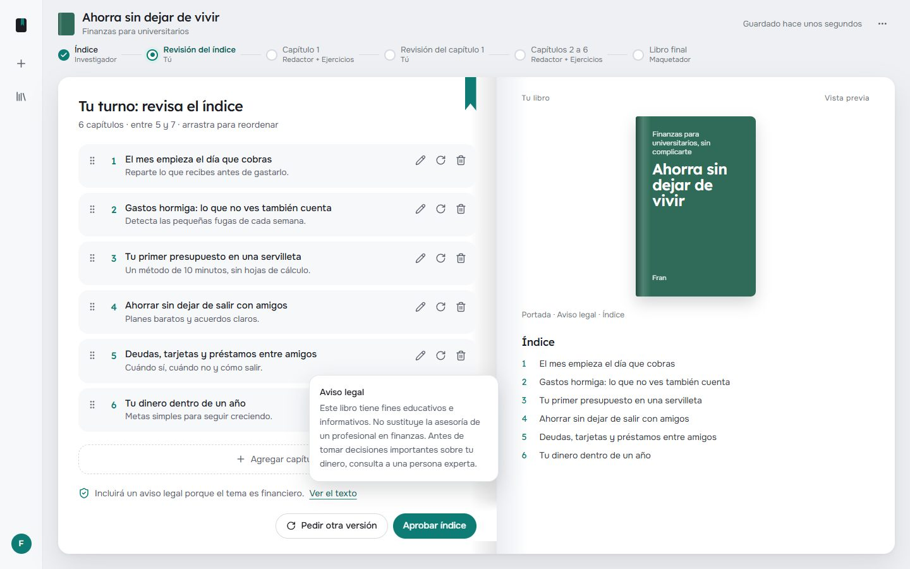 | 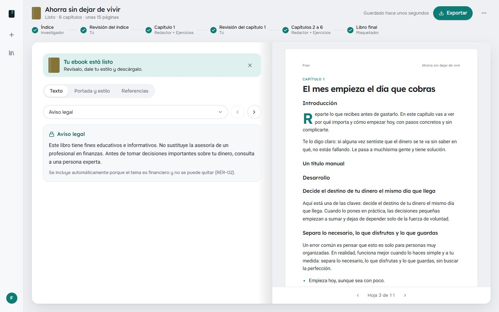 | 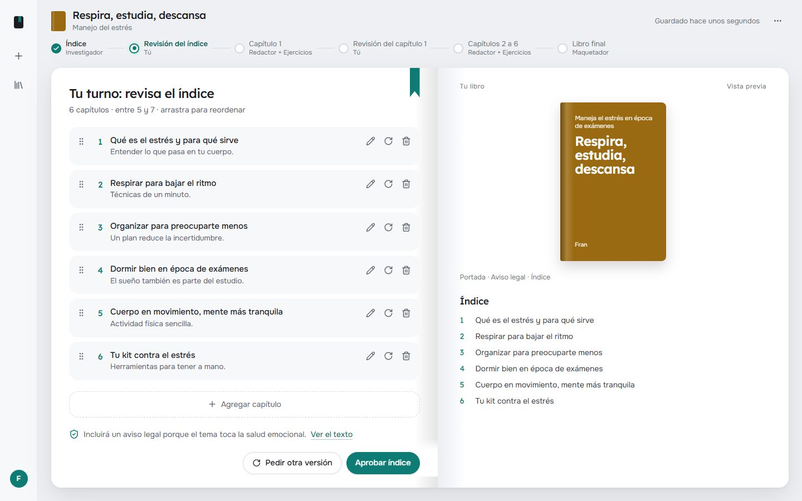 |

---

### RÉR-03 · Mitigación de sesgos y estereotipos — 🟡 Implementado; falta medirlo con el modelo real

**Qué pide:** ejemplos cotidianos sin estereotipos de género ni discriminación, y sin soluciones poco éticas.

**Cómo lo cumple hoy**
- Los ejemplos usan 12 personas (6 mujeres y 6 hombres) con contextos que no siguen estereotipos: Valentina estudia Ingeniería Mecánica, José estudia Enfermería, Diego cuida a su hermano menor, Sofía repara celulares…
- Las personas **rotan a lo largo del libro** y dos capítulos seguidos nunca repiten género. Cada libro recibe una rotación distinta: en la última ejecución de la prueba salieron Tomás, Valentina, Samuel, Daniela, Andrés y Sofía (3 mujeres y 3 hombres).
- Las soluciones propuestas son hábitos y acciones responsables (planificar, ahorrar, conversar).

**Con backend:** el prompt del Redactor exige personas diversas en nombre, edad, género, origen, familia y trabajo, roles que no dependen del género y soluciones éticas (`backend/app/prompts/redactor/capitulo.md:33`). Además, el orquestador le sugiere personas que rotan por el libro como en el modo demo; lo prueba `test_personas_diversas_rer03`.

**Falta:** una revisión automática de sesgos antes de mostrar cada capítulo y revisar por muestreo un libro escrito por Gemini.

**Dónde está:** personas `frontend/src/lib/api/mock/content.ts:246`; rotación `content.ts:415`; resultado en [`verificacion/RER-03-personas.json`](verificacion/RER-03-personas.json)

**Prueba:** `RÉR-03` extrae las personas de todos los ejemplos del libro y comprueba que aparecen mujeres y hombres.

---

## Requerimientos derivados añadidos en la fase 4

### RD-04 · Edición de portada (ampliada) — ✅ Cumple

**Qué pide (D-37):** además del título, el autor, la plantilla y el color, poder subir una imagen propia, elegir la letra, el tamaño y la alineación del título y tener contraportada, sin romper RA-03.

**Cómo lo cumple**
- **Portada y estilo** tiene tres vistas, cada una con su vista previa a la derecha: Portada, Contraportada e Interior.
- **Cinco plantillas** (Clásica, Centrada, Franja, Marco y Editorial), **letra del título** (Lexend, Onest o Roboto), **tamaño** (pequeño, mediano o grande) y **alineación**.
- **Imagen propia** de fondo o en recuadro, con encuadre y texto alternativo. De fondo, un **velo del color de tela** la cubre lo justo para que el título blanco tenga 4,5:1 o más: Folio mide el 5 % de píxeles más claros, calcula el velo mínimo y el control no deja bajar de ahí. Si cambias la tela, el mínimo se recalcula; con backend lo calcula el servidor.
- **Contraportada** con la sinopsis que propone el Maquetador, editable y con "Pedir otra sinopsis". Sale en el PDF y como "Sobre este libro" en el `.md`.

**Dónde está:** `frontend/src/components/workspace/stages/DesignPanel.tsx`; plantillas `frontend/src/components/book/Cover.tsx`; contraportada `frontend/src/components/book/BackCover.tsx`; velo mínimo `frontend/src/lib/cover-image.ts`; en el PDF, `backend/app/export/templates/libro.html.j2`.

**Prueba:** `RD-04` (`portada-referencias.spec.ts`) elige la plantilla Marco, Onest y tamaño grande, sube una imagen clara y comprueba que el contraste con el velo es de 4,5:1 o más y que el control no baja del mínimo; luego la pasa a recuadro y pide otra sinopsis. En el backend, el servidor calcula el velo mínimo con el mismo algoritmo y lo aplica solo (`test_el_servidor_calcula_el_velo_minimo_y_lo_sube_en_silencio`, `test_velo_minimo_igual_que_el_frontend`).

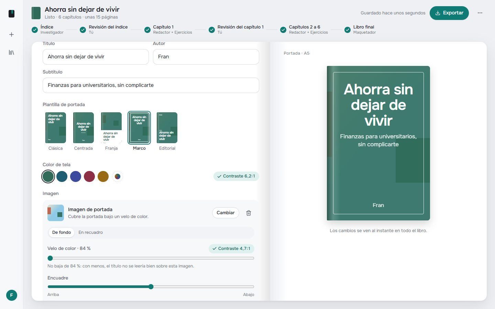

---

### RD-09 · Ayuda con las referencias bibliográficas — ✅ Cumple

**Qué pide (D-38):** que el sistema ayude con las referencias: sugerir lecturas, comprobar que existan, permitir agregarlas y corregirlas, y darles formato.

**Cómo lo cumple**
- Al aprobar el índice, el **Investigador sugiere lecturas reales** relacionadas con el tema y los capítulos, sin frenar la redacción.
- Folio las **verifica** en **Crossref** (DOI) y **Open Library** (ISBN o título y autor): *Verificada*, *No la encontramos* (posible invención) o *Sin verificar*. Si la fuente tiene otro año o datos que faltan, ofrece "Usar esos datos".
- Pestaña **Referencias**: buscar por título, autor, DOI o ISBN, agregar a mano (libro, artículo o página web), editar, quitar, volver a comprobar y **"Copiar cita"** en APA, por ejemplo "(Housel, 2020)".
- Se exportan al final del libro como **Referencias** en **APA 7 en español**, ordenadas por apellido. El diálogo de exportar avisa si alguna no se encontró.

**Dónde está:** `frontend/src/components/workspace/stages/ReferencesPanel.tsx`; formato `frontend/src/lib/references/apa.ts` y `backend/app/references/apa.py`; verificación `frontend/src/lib/references/lookup.ts` y `backend/app/references/verify.py`; lecturas del Investigador `backend/app/prompts/investigador/lecturas.md`.

**Prueba:** `RD-09` (`portada-referencias.spec.ts`, con Crossref y Open Library simuladas) comprueba las lecturas verificadas del libro de ejemplo; agrega una por DOI (queda *Verificada en Crossref*) y otra inventada (*No la encontramos*); copia la cita "(Housel, 2020)"; y exporta el `.md` con la sección Referencias en APA 7. En el backend hay 20 pruebas entre `test_references.py` y `test_apa.py`.

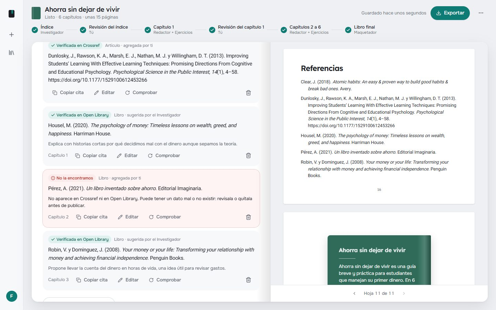

---

## Defectos encontrados y corregidos durante esta verificación

La verificación no se limitó a confirmar: encontró problemas reales, que ya están corregidos. En la fase 4, además, dos revisiones de código independientes (frontend y backend) encontraron **27 errores** que no cubría ninguna prueba; se corrigieron todos y cada uno tiene ahora su prueba (ver [11-backend](./11-backend.md) §7). Los más importantes están en la tabla.

| Requerimiento | Problema | Corrección |
|---|---|---|
| RÉR-03 | Algunos contextos repetían estereotipos (mujer enfermera y cuidadora, hombre futbolista). | Se reescribieron los perfiles con roles no estereotipados. |
| RÉR-03 | Las personas se elegían al azar por capítulo y un libro salió con 6 mujeres y 0 hombres (la prueba falló). | Ahora rotan a lo largo del libro y alternan el género. |
| RA-01 | El PDF no tenía H1: el título estaba oculto y los niveles empezaban en H2. | Portadilla visible con el título en H1; capítulos en H1, secciones en H2 y subtemas en H3. |
| RA-01 | En la vista previa, los subtemas tenían el mismo nivel que las secciones. | Los subtemas bajaron un nivel. |
| RD-03 | En el libro abierto, ninguna de las dos páginas tenía scroll propio: la vista previa nunca se desplazaba al capítulo que se editaba. | La fila del libro abierto se limita a la altura de la pantalla y cada página se desplaza por separado (fase 4). |
| RA-01 | En el PDF del servidor, los marcadores de los títulos largos perdían espacios ("estudia,descansa"): Chromium junta las líneas sin espacio. | Se restaura el texto real de cada marcador tras generar el PDF; lo prueba `test_pdf_outline.py`. |
| RD-06 | Las miniaturas de plantilla leían todo el texto de la portada como nombre del botón. | La miniatura es decorativa y el botón se llama como la plantilla. |
| RD-06 | El gris `tenue` no llegaba a 4,5:1 sobre la mesa y la barra; el botón de peligro en tema oscuro tenía 2,5:1; los controles deslizantes medían 16 px de alto. | Nuevo `tenue` `#646A76` (4,8:1 sobre la mesa), texto oscuro en el botón de peligro (7,2:1) y controles de 24 px. axe-core: 0 infracciones en 20 pantallas (claro y oscuro). |
| RA-03 | Con la tela Ocre y una imagen muy clara, el velo tope (95 %) dejaba el título en 4,3:1; además, el velo mínimo lo decidía el navegador. | El velo llega hasta el 100 % y el servidor calcula el mínimo con el mismo algoritmo que el frontend y lo aplica solo. |
| RF-05 | Si el servidor se caía justo en la pausa del capítulo 1, al volver podía seguir escribiendo sin la aprobación. | Se guarda que el capítulo 1 está aprobado y el Redactor no escribe el resto sin esa marca. |
| RD-03 | Con backend, al hacer una pausa después de un espacio, el servidor lo recortaba y las palabras se pegaban; vaciar el título daba un error. | El servidor guarda el texto tal cual mientras se edita y lo limpia al exportar; un título vacío espera en pantalla. |
| RD-03 | Reintentar un capítulo cuyo único fallo fue el ejercicio lo reescribía entero y perdía lo editado. | Se guarda en qué fase falló y solo se repite esa. |
| RD-01 | Cambiar la contraseña no cerraba las sesiones abiertas; el inicio de sesión delataba por tiempo si una cuenta existía. | El token lleva una huella de la contraseña; scrypt corre en un hilo y con un hash de relleno. |
| RD-09 | Una referencia editada mientras se comprobaba quedaba «Comprobando…» para siempre; en el modo demo, «Mr. Mercedes» se daba por igual a «Mr. Bean». | La comprobación se repite con los datos nuevos; los títulos se comparan como en el backend. |
