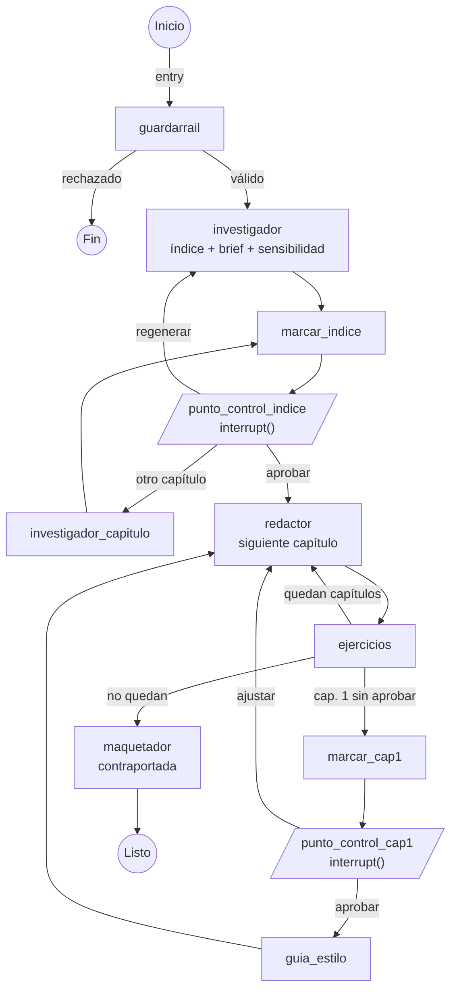

# 11 · Backend multiagente (fase 4)

> **Estado:** implementado el 2026-10-20 en [`backend/`](../backend). Sigue la arquitectura de [03-arquitectura](./03-arquitectura.md) y las decisiones D-34 a D-41 de [06-decisiones](./06-decisiones.md).
> Cómo ejecutarlo: [`backend/README.md`](../backend/README.md). Cómo lo usa el frontend: [08-frontend](./08-frontend.md) §2.

## 1. Qué incluye

| Pieza | Implementación | Requerimientos |
|---|---|---|
| API | **FastAPI** con rutas REST para cuentas, ebooks, pausas, edición, diseño, imágenes, referencias y exportación, y **SSE** para el avance en vivo | RF-05, RF-06, RD-01 a RD-09 |
| Orquestador | **LangGraph** con `interrupt()` en los dos puntos de control y **checkpointer en SQLite**: si el servidor se reinicia, cada ebook sigue donde estaba | RF-05, RD-07 |
| Agentes | Cuatro módulos (`app/agents/`): **Investigador**, **Redactor**, **Ejercicios** y **Maquetador**, con los prompts en archivos aparte (`app/prompts/<agente>/<tarea>.md`) | RNF-04 |
| Capa LLM | Interfaz `LLMProvider` con **Gemini** (por defecto, REST), **Claude**, **OpenAI** y **demo** (sin conexión). Se elige con `LLM_PROVIDER` | D-34 |
| Guardarraíl | Patrones de ficción + clasificación del LLM antes de crear el ebook y otra vez dentro del grafo | RF-01 |
| Referencias | Lecturas sugeridas por el Investigador, verificación en **Crossref** y **Open Library**, búsqueda por DOI, ISBN o título y formato **APA 7** | RD-09, RÉR-01 |
| Exportación | Markdown con jerarquía H1/H2/H3 y **PDF etiquetado** con Chromium headless (Playwright), fuentes incrustadas y metadatos de IA | RF-06, RA-01, RA-03, D-39 |
| Datos | **SQLite** local (`backend/data/`): cuentas (scrypt + JWT), ebooks, imágenes y checkpoints | D-35 |

## 2. Grafo de agentes

- **El contenido vive en el store; el grafo solo guarda por dónde va.** El estado del grafo es mínimo (`ebook_id`, `entry` y la última acción), y los nodos leen y escriben el ebook en `app/store.py`. Así, editar el índice o el capítulo 1 durante una pausa no exige pasar por el grafo.
- **Cada punto de control son dos nodos:** `marcar_*` fija el estado (`indice_pendiente`, `cap1_pendiente`) y emite `checkpoint.required` solo si cambia; `punto_control_*` solo llama a `interrupt()`. LangGraph vuelve a ejecutar el nodo interrumpido al reanudar, así que de este modo ningún efecto se repite.
- **Un capítulo por paso:** el Redactor escribe un capítulo y el agente de Ejercicios lo cierra; cada capítulo es un *checkpoint*. Si el servidor se cae en el capítulo 4, al volver retoma el 4.
- **Entradas (`entry`):** el grafo puede empezar en el guardarraíl, en una pausa o en la redacción. Se usa para duplicar un ebook en pausa y para recuperarse si falta el checkpoint.
- **Cancelar** durante una regeneración corta la tarea, restaura la versión anterior y vuelve a dejar el grafo en la pausa.
- **Lecturas recomendadas:** se piden al aprobar el índice, en una tarea aparte que no frena la redacción.

## 3. Agentes y prompts (RNF-04)

| Agente | Tareas (un prompt cada una) | Salida |
|---|---|---|
| Orquestador | `orquestador/guardarrail.md` | Válido o no, motivo amable, nicho, sensibilidad y 3 alternativas |
| Investigador | `investigador/indice.md`, `capitulo_alternativo.md`, `lecturas.md` | Título, subtítulo, público, sensibilidad, *brief* y 5-7 capítulos; reemplazo de un capítulo; 4-8 lecturas reales |
| Redactor | `redactor/capitulo.md`, `guia_estilo.md` | Capítulo en Markdown con las cuatro secciones, en streaming; guía de estilo a partir del capítulo 1 aprobado |
| Ejercicios | `ejercicios/ejercicio.md` | Checklist de autoevaluación (5-7 elementos) o reto de 24/48 h (3-5 pasos) |
| Maquetador | `maquetador/contraportada.md` + plantillas de exportación | Sinopsis de 60-110 palabras; libro en `.md` y PDF |

Cada archivo de prompt tiene un encabezado YAML con la temperatura y el máximo de tokens, y dos bloques (`---sistema---` y `---usuario---`). Cambiar el comportamiento de un agente es editar su archivo, sin tocar código.

**Reglas que los prompts dejan explícitas:**

- **Tono (RNF-01, RA-02):** conversacional, empático y directo, con tuteo, frases cortas, vocabulario cotidiano y profundidad intermedia. Hay una lista de muletillas prohibidas.
- **Estructura (RF-03):** exactamente `## Introducción`, `## Desarrollo`, `## Ejemplos cotidianos` y `## Conclusión`, en ese orden, con extensión orientativa por sección. El código lo comprueba al terminar y reintenta si falta alguna; cualquier `#` o `##` extra se convierte en `###` (RA-01).
- **Coherencia (RNF-03):** cada capítulo recibe el índice completo, el *brief*, la guía de estilo, **el capítulo 1 aprobado como referencia** y el resumen y la conclusión de los anteriores, para no repetir ni contradecir. Los capítulos 2 a N se escriben en orden (D-09).
- **Originalidad (RÉR-01):** contenido original, sin copiar ni parafrasear de cerca y sin inventar estudios, cifras ni citas. Si Gemini corta una respuesta por `RECITATION` (parecido con un texto existente), se pide otra versión.
- **Sesgos (RÉR-03):** personas diversas en nombre, edad, género, origen, familia y trabajo; roles que no dependen del género; soluciones éticas y realistas.
- **Temas sensibles (RÉR-02):** el Investigador asigna la categoría (nunca baja a "ninguno" si el nicho es sensible) y el Redactor evita el consejo prescriptivo y sugiere ayuda profesional cuando corresponde. El aviso legal lo inserta el Maquetador y la API no deja quitarlo.
- **Ejercicios (RF-04):** solo checklist o reto de 24/48 h; el tipo lo decide el orquestador (con "que decida Folio", retos en capítulos impares y checklists en pares) y se valida la respuesta.

## 4. Rendimiento (RNF-02)

- Streaming desde el primer token: el Redactor reparte el texto por secciones mientras llega.
- Tiempo límite de **60 s por capítulo** (`CHAPTER_TIMEOUT_S`), **un reintento automático** y luego un error reintentable ("No pudimos terminar el capítulo N").
- Con Gemini se pide un razonamiento corto (`GEMINI_THINKING_LEVEL=low`) para no alargar la espera.

## 5. Referencias (RD-09)

1. Al aprobar el índice, el Investigador propone de 4 a 8 obras reales (libros y artículos revisados por pares), con los capítulos con los que se relacionan y por qué se recomiendan. El prompt le prohíbe inventar DOI o ISBN.
2. Cada referencia se **verifica**: con DOI en Crossref, con ISBN en Open Library y, si no, buscando por título y autor. Coincide si el título se parece en un 80 % o más y al menos un apellido coincide.
3. Resultado: `verificada` (con la fuente), `no_encontrada` (posible invención: la interfaz y la exportación lo advierten) o `sin_verificar` (sin conexión o página web). Si la fuente tiene otro año o datos que faltan (DOI, volumen, páginas…), se ofrecen para corregir con un clic.
4. Se exportan como la sección **Referencias** en **APA 7** (versión en español: "y" entre autores, "s. f." sin fecha), ordenadas por apellido. `app/references/apa.py` y `frontend/src/lib/references/apa.ts` aplican las mismas reglas.

## 6. Exportación (RF-06, RA-01, RA-03)

- **Markdown:** `# Título` → `*subtítulo*` → `Por autor` → `## Aviso legal` (cita) → `## Índice` → `# Capítulo N: …` con `## Sección` y `###` internos → `# Referencias` → `# Sobre este libro` (contraportada) → nota de IA y comentario legible por máquina (D-39).
- **PDF:** plantilla HTML (Jinja2) con la portada a página completa (las cinco plantillas, imagen y velo), portadilla, aviso legal, índice, capítulos, referencias con sangría francesa y contraportada. Fondo blanco, texto `#1B1D23`, Roboto/Arial/Helvetica de 11 a 13 pt, `@page` según el tamaño elegido y número de página al pie. Chromium genera el PDF **etiquetado** (`/StructTreeRoot`, H1/H2/H3) con marcadores, y pypdf añade título, autor y la marca de IA en los metadatos. Las fuentes (Roboto, Lexend y Onest, licencia OFL) van incrustadas. Como Chromium junta sin espacio las líneas de un título largo al crear los marcadores, se restaura el texto real de cada marcador después de generar el PDF.
- **Ejemplo real** generado por el backend (proveedor demo, portada Editorial con imagen, 7 lecturas verificadas contra Crossref y Open Library): [`verificacion/ebook-ejemplo-servidor.pdf`](verificacion/ebook-ejemplo-servidor.pdf) y [`.md`](verificacion/ebook-ejemplo-servidor.md).

## 7. Pruebas

**Backend: `pytest`, 122 de 122 superadas (2026-10-20, unos 45 s).** Usan el proveedor demo, una base de datos temporal y **no salen a la red**: Crossref, Open Library y Gemini se simulan con `httpx.MockTransport`.

| Archivo | Pruebas | Qué comprueba |
|---|---|---|
| `test_flow.py` | 1 | El flujo completo por la API: crear → índice (5-7) → editar, regenerar y cancelar → aprobar → capítulo 1 (4 secciones + ejercicio) → ajustar y restaurar → aprobar → libro listo con referencias y contraportada → `.md` (jerarquía sin saltos, H1 por capítulo, aviso legal, nota y marca de IA) → PDF con `/StructTreeRoot`, H1/H2/H3 y metadatos |
| `test_sse.py` | 1 | Eventos `ebook.updated`, `token` y `checkpoint.required` contra un uvicorn real |
| `test_resume_retry.py` | 5 | Reinicio en una pausa y a mitad de un capítulo, tiempo límite con reintento automático, error forzado con reintento y duplicar en pausa |
| `test_guardrail_validations.py` | 6 | Ficción rechazada con alternativas y veredicto reutilizado; validaciones del índice (5-7 capítulos), del diseño (contraste de la tela con tono sugerido) y de la imagen de portada (que sea de la cuenta) |
| `test_agents.py` | 11 | Reparto del stream en secciones, conversión de encabezados a `###` (RA-01), tipo y validación de los ejercicios (RF-04) y personas diversas (RÉR-03) |
| `test_references.py` · `test_apa.py` | 13 · 7 | Búsqueda por DOI, ISBN y título, verificación (coincide, no existe, datos distintos) y formato APA 7 |
| `test_llm.py` · `test_llm_sdks.py` | 10 · 2 | Adaptador de Gemini (petición, respuesta normal y SSE, `thinkingConfig`, reintentos ante 429), JSON inválido corregido, demo sin clave, reglas explícitas en los prompts y adaptadores de Claude y OpenAI |
| `test_auth.py` | 7 | Registro, entrada, errores de validación, rutas protegidas, ebooks de otra persona, perfil, borrar cuenta y recuperar la contraseña |
| `test_pdf_outline.py` | 2 | Los marcadores del PDF conservan los espacios de los títulos largos |
| `test_live_edit.py` | 3 | Edición en vivo sin recortar espacios (se limpia al exportar), `#hashtag` no es un encabezado, velo hasta 1 y año «2018a» |
| `test_revision_flujo.py` | 8 | Reintentar solo el ejercicio conserva lo editado; un reinicio en la pausa del capítulo 1 no la salta (RF-05); el historial del índice no se duplica; freno a fallos que se repiten sin fin |
| `test_revision_diseno.py` | 19 | Velo mínimo calculado en el servidor igual que en el frontend (56 casos) y aplicado solo; cambios de diseño simultáneos; la sinopsis escrita a mano no se pisa |
| `test_revision_llm.py` | 16 | El parser del Redactor solo cambia de sección con `#`/`##` y hacia delante; capítulos cortados por el límite de tokens (Gemini, Claude y OpenAI); esperas ante 429; tiempo límite global; errores de red traducidos |
| `test_revision_seguridad.py` | 6 | El cambio de contraseña invalida los tokens; scrypt en un hilo y sin delatar cuentas; registros simultáneos; solo enlaces http(s); el `.md` sin HTML crudo; borrar un ebook no borra imágenes ajenas |
| `test_revision_infra.py` | 5 | Una referencia editada mientras se comprueba no queda pendiente; clientes SSE que no leen; escritura diferida que se reintenta; tiempo límite del PDF |

**Punta a punta: `npm run test:e2e:backend` (frontend).** Levanta el backend (proveedor demo, datos temporales) y el frontend en modo `http`, y recorre en el navegador: crear cuenta, rechazo de ficción en el servidor, índice de 5 capítulos, agregar uno, **recargar y seguir en la misma pausa**, aprobar, capítulo 1 con sus cinco secciones, escribir el resto, editar (H1 → H3), cambiar la plantilla, subir una imagen, contraportada, agregar una referencia, exportar el PDF (etiquetado, H1/H2/H3) y el `.md` desde el servidor, y cerrar sesión y volver a entrar con los datos intactos. **Superada (unos 25 s).**

**Revisión de código.** Dos revisiones independientes encontraron 13 errores en el backend y 14 en el frontend que no cubría ninguna prueba; todos se corrigieron, y las pruebas `test_revision_*.py` y `test_live_edit.py` fallan con el código anterior y pasan con el nuevo. También se recorrió la app con el backend real en el navegador (54 comprobaciones: escritura en vivo, cancelar, ajustes del capítulo 1, dos pestañas sincronizadas, referencias contra Crossref y Open Library reales, caída y reconexión del servidor, recuperación de contraseña…) y se pasó axe-core por las 20 pantallas.

Además, el agente que construyó el backend arrancó el servidor real y comprobó con `curl` el flujo completo, la verificación de las 7 lecturas sugeridas contra **Crossref y Open Library reales**, CORS y la recuperación de un ebook tras matar el servidor a mitad del trabajo.

## 8. Limitaciones y siguientes pasos

- Se ejecuta en local (P-08). Para publicarlo hace falta un servidor con Python y Chromium; Supabase (D-13) es la opción prevista para cuentas y datos.
- No hay envío de correos: el enlace para recuperar la contraseña aparece en la consola del servidor.
- La calidad del texto depende del modelo. Con el proveedor demo (sin clave) los textos son plantillas, útiles para probar el flujo pero no para evaluar la redacción.
- Falta revisar el PDF con un lector de pantalla real (NVDA).
